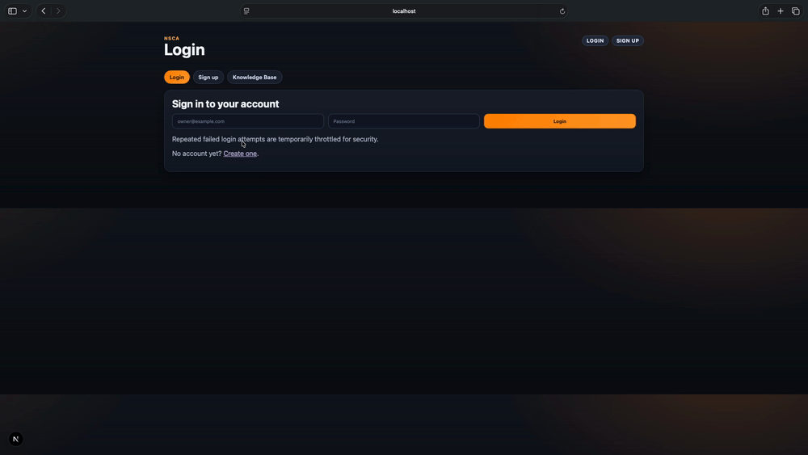
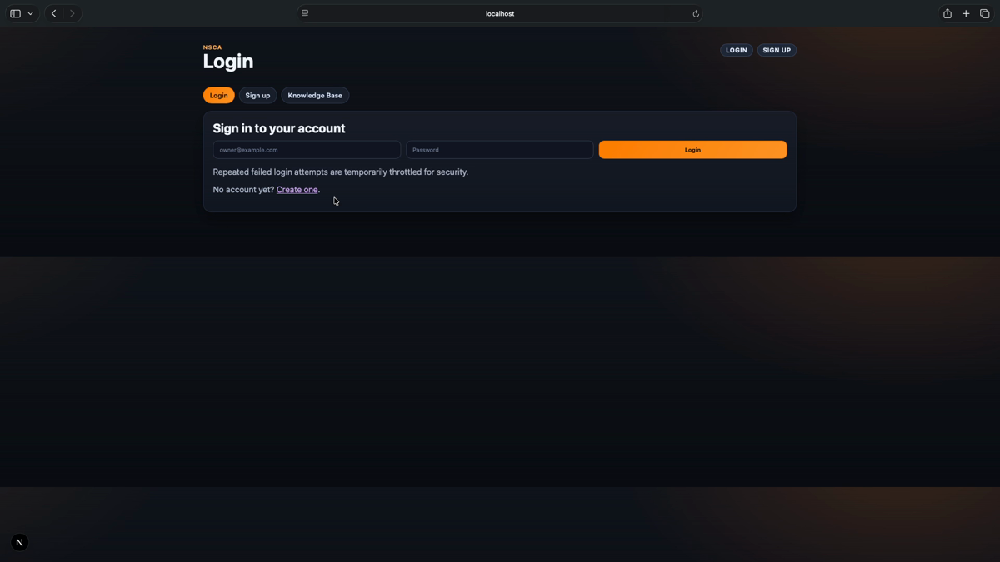
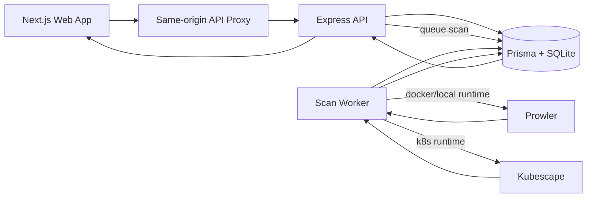

# Cloud Security Posture Management (CSPM) Platform

<p align="center">
  <strong>A Prowler-powered multi-tenant CSPM control plane for MSPs, MSSPs, and security teams.</strong>
</p>

<p align="center">
  <a href="https://github.com/macminitm/cloud-security-posture-management/actions/workflows/ci.yml">
    
  </a>
  
  
  
  
  
</p>

<p align="center">
  <a href="#quick-start-5-minutes">Quick Start</a> •
  <a href="#what-problem-this-solves">Problem</a> •
  <a href="#how-we-leverage-prowler">How Prowler Fits</a> •
  <a href="#features">Features</a> •
  <a href="#license">License</a>
</p>

## Why This Repo Exists

This project turns open-source cloud security scanners (primarily <strong>Prowler</strong>, plus <strong>Kubescape</strong> for Kubernetes) into a practical web application and operating model:

- multi-tenant onboarding
- integration lifecycle management
- queue/worker scan execution
- normalized findings and dashboards
- MSP parent/child customer operations
- scan profile controls per tenant/provider

The goal is not "another scanner CLI." The goal is a usable <strong>control plane</strong> around scanners so teams can operate CSPM at customer scale.

## Product Preview

<p align="center">
  <a href="docs/assets/readme-ui-preview.mp4" title="Open compressed UI walkthrough preview (.mp4)">
    
  </a>
</p>

<p align="center">
  <em>Click the GIF to open a compressed walkthrough preview (.mp4).</em>
</p>

<p align="center">
  
</p>

## What Problem This Solves

### The gap

Open-source scanners like Prowler are powerful, but operating them repeatedly across many tenants/customers usually means building your own:

- onboarding workflow
- auth/RBAC
- scan scheduling/queueing
- result ingestion and normalization
- dashboards and triage UX
- auditability and tenant isolation controls

### What this repo provides

This repo is the platform layer that sits on top of scanners.

It helps you go from:
- "I can run Prowler manually" to
- "I can operate cloud posture scans for multiple customers in a web app"

## Who This Helps

### MSP / MSSP teams

- Manage multiple customer tenants from one UI
- Operate a parent-child tenant model
- Standardize scan profiles by provider/customer
- Reduce repeated CLI/manual scanning work

### Internal cloud security teams

- Centralize integrations and scan execution
- Give analysts a web UI instead of raw scanner output
- Add role-based access and audit trails around scanning operations

### Builders / platform engineers

- Use this as a reference implementation for Prowler-backed CSPM workflows
- Extend integrations, profiles, dashboards, exports, and automations

## Benefits You Get

- Faster onboarding from clone -> local stack -> first scan
- Multi-provider integration UX (11 providers supported in this repo)
- Prowler/Kubescape execution through a worker runtime
- Normalized findings storage and dashboarding
- MSP-aware tenancy model and cross-tenant inventory/management APIs
- Integration secrets encrypted at rest (app-layer encryption)
- Persisted tenant default scan profiles (per provider)
- Safer local dev workflow (Next.js dev/build cache separation)

## How We Leverage Prowler

This application uses Prowler as the scanning engine for non-Kubernetes providers.

### Architecture (high level)



### Important behavior (operator clarity)

- `Test AWS connection` does <strong>not</strong> run Prowler.
  - It uses the AWS SDK (`STS AssumeRole`) from the API to validate role access.
- `Queue scan` <strong>does</strong> run the scanner path.
  - The worker claims the scan job and invokes Prowler (or Kubescape for Kubernetes).

This split is intentional:
- fast credential validation first
- expensive scans only when explicitly queued

### What this means

Prowler remains the scanner engine.
This repo adds the operational platform around it.

## Features

### Core Platform

- Multi-tenant auth + RBAC (`OWNER`, `ADMIN`, `ANALYST`, `VIEWER`)
- Next.js web UI + same-origin API proxy + HttpOnly session cookie
- Express API + Prisma persistence
- Worker-based scan queue processing
- Audit logging for key actions

### Integrations (supported in this repo UI/API)

- AWS
- Azure
- GCP
- Kubernetes (Kubescape-backed)
- Microsoft 365
- GitHub
- MongoDB Atlas
- Oracle Cloud
- Alibaba Cloud
- Cloudflare
- OpenStack

### Scanning and Findings

- Queue scans per integration
- Persist scan lifecycle (`QUEUED`, `RUNNING`, `COMPLETED`, `FAILED`)
- Store scanner artifacts and provenance metadata
- Normalize findings into queryable tables
- Findings filtering and bulk status updates
- Posture and executive dashboards

### MSP / Multi-Customer Operations

- Parent-child tenant hierarchy
- Parent visibility into child integrations (global inventory endpoints)
- Cross-tenant management for authorized MSP parent roles
- Tenant-specific default scan profiles per provider

### Scan Profiles (Operator UX)

- Queue-time scan profile controls (framework/compliance/filters)
- Persisted tenant defaults per provider (save/load/delete)
- Curated dropdowns/multi-selects for many provider fields:
  - frameworks
  - compliance frameworks
  - severity threshold
  - services (where catalog exists)
  - categories (where catalog exists)
  - regions (where catalog exists)
- CSV fallback for fields/providers without a catalog yet

### Security and Secrets Handling (Current Implementation)

- Integration secrets can be pasted in the UI
- Sensitive integration values are encrypted before DB storage (`enc:v1:` app-layer encryption)
- Sensitive values are redacted in API/UI responses after save
- Worker decrypts sensitive values at runtime before scanner execution
- Auth hardening includes password policy, login throttling/lockout, and token revoke endpoint

## Quick Start (5 minutes)

### Prerequisites

- Node.js `>=20.11`
- Docker (or Colima/Docker Desktop) for default scanner runtime
- `npm`

### 1. Clone and install

```bash
git clone https://github.com/macminitm/cloud-security-posture-management.git
cd cloud-security-posture-management
npm install
```

### 2. Configure environment

```bash
cp .env.example .env
```

Optional but recommended for local multi-provider testing:

```bash
# show all providers in UI (not AWS-only mode)
echo "AWS_FIRST_MODE=false" >> .env
```

### 3. Prepare database + scanners

```bash
npm run db:generate
npm run prisma:push -w @cspm/api
npm run demo:seed
npm run scanners:preflight
```

If scanner preflight fails due to Docker not running, start Docker/Colima and retry.

### 4. Start the stack

```bash
npm run dev:up
npm run health
```

Open:
- Web UI: `http://127.0.0.1:3000`
- Login: `http://127.0.0.1:3000/login`
- Integrations: `http://127.0.0.1:3000/integrations`

### Demo credentials (seeded)

- Owner: `demo-owner@cspm.local` / `DemoPilot!2026`
- Analyst: `demo-analyst@cspm.local` / `DemoPilot!2026`

Seeded demo data includes:
- MSP parent tenant + linked customer tenant
- multi-provider integrations (AWS, Azure, GCP, GitHub)
- saved tenant scan profiles
- sample scan jobs (queued/running/completed/failed)
- findings/assets/audit log records for UI walkthroughs

### 5. First run (UI)

1. Log in with a demo account above (or sign up to create your own tenant)
2. Go to `Integrations`
3. Add an integration
4. For AWS, run `Test AWS connection` before saving
5. Save integration
6. Queue scan
7. Review findings/dashboard

## Local Development Workflow

### Dev stack commands

```bash
npm run dev:up       # start api + worker + web
npm run dev:status   # show PIDs and logs
npm run dev:logs     # tail logs
npm run dev:doctor   # diagnose port conflicts
npm run dev:down     # stop stack
npm run health       # health checks (web/api/worker)
```

### Quality checks

```bash
npm run test
npm run typecheck
npm run build
```

## Scanner Runtime Notes

Default scanner runtime is Docker-based and uses pinned images.

- Prowler: `ghcr.io/prowler-cloud/prowler:4.6.0`
- Kubescape: `quay.io/kubescape/kubescape:v3.0.26`

If scanner runtime is missing/misconfigured, scans fail with explicit errors and scan metadata captures failure context.

## Provider Capabilities and Scan Profile Catalog Overrides

Provider scan capabilities (frameworks, profile options, and curated dropdown values) can be overridden at runtime with:

- `PROVIDER_CAPABILITIES_FILE` (default: `./.runtime/provider-capabilities.json`)

Example shape:

```json
{
  "AWS": {
    "frameworks": ["CIS", "PCI-DSS"],
    "profileOptions": ["framework", "services", "regions", "severityThreshold"],
    "optionValues": {
      "services": ["iam", "s3", "ec2"],
      "regions": ["us-east-1", "us-west-2"],
      "categories": ["identity", "networking", "encryption"]
    }
  }
}
```

## Why This Repo Is Public

This repository is public on purpose.

### 1. Transparency

Security tooling benefits from visibility into how it works:
- auth model
- tenant boundaries
- scanner execution paths
- secret handling patterns
- operational tradeoffs

### 2. Reusability

Many teams need the same platform layer around scanners. A public repo reduces duplicated effort and helps teams start from a working baseline.

### 3. Collaboration

Public code enables:
- issue-driven improvements
- MSP/operator feedback
- implementation review
- feature contributions (providers, dashboards, automations)

### 4. Learning Reference

This repo is also a practical reference for building scanner-backed security web apps (queue/worker + normalized findings + tenant UX).

## Current Positioning (Important)

- This is a <strong>Prowler-powered platform layer</strong>, not a full drop-in replacement for every upstream Prowler capability.
- It is strongest for multi-tenant operations, integrations, queue/worker orchestration, and UI-driven CSPM workflows.
- Prowler parity is still partial in some advanced areas (depth/reliability/features), and the docs in `docs/` track that work.

## Roadmap / Next High-Value Areas

- Deeper provider option catalogs sourced from Prowler metadata
- Durable distributed auth lockout/revocation state (Redis/DB)
- Enterprise-grade secrets backend (KMS/Vault/Secret Manager abstraction)
- More robust scheduling and worker orchestration
- Expanded reporting, compliance mapping, and automation outputs

## Docs

- `docs/INTEGRATIONS.md` - integration setup and cloud-side prerequisites
- `docs/TODO.md` - consolidated implementation backlog/status
- `docs/SPRINT_PILOT_HARDENING.md` - pilot hardening checklist/status
- `docs/MSP_PILOT_READINESS_RECONCILIATION.md` - MSP pilot readiness reconciliation
- `docs/SECURITY_PILOT_SIGNOFF_EVIDENCE.md` - signoff evidence log

## Contributing

Contributions are welcome.

- Read `CONTRIBUTING.md` for setup, testing expectations, and PR guidelines
- Read `CODE_OF_CONDUCT.md` for community expectations
- Read `SECURITY.md` for vulnerability reporting guidance
- Use the GitHub issue templates for bugs and feature requests
- Do not submit real cloud credentials/secrets in issues, PRs, screenshots, or test fixtures

## License

This repository is licensed under the <strong>Apache License 2.0</strong> (see `LICENSE`).

Why Apache-2.0 here:
- permissive for commercial/internal use
- contributor-friendly for public collaboration
- clear patent grant language
- compatible with a public, extensible platform approach

### Prowler attribution

This project integrates with and depends on the Prowler open source project as a scanner engine, but it is a separate application and repository.

- Prowler project: https://github.com/prowler-cloud/prowler
- Prowler license: Apache-2.0

See `NOTICE` for attribution notes.

## Disclaimer

This project is a security platform scaffold / evolving implementation. Review, harden, and validate before production use. In particular:

- deploy behind HTTPS/TLS
- use managed secrets/KMS
- review tenant isolation and auth controls
- validate scanner credentials and runtime isolation
- run your own security testing and compliance checks
